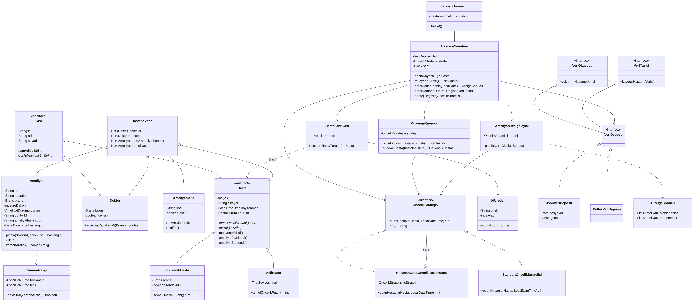

# Hastane Planlama Sistemi

Nesneye Yönelik Programlama dersi proje ödevi — Kırklareli Üniversitesi, Yazılım Mühendisliği.

**Konu:** Hastane Planlama Sistemi — hasta önceliklendirme, doktor ve ameliyathane çizelgeleme.

Konsol üzerinden çalışan bir Java uygulamasıdır. Acil servis ve poliklinik hastalarını triaj rengi ve bekleme süresine göre önceliklendirir, ameliyat taleplerini branşa uygun cerrahlara ve boş ameliyathanelere **hiç çakışma olmadan** yerleştirir. Bir ameliyathane arızalandığında plan otomatik olarak yeniden hesaplanır. Tüm veriler `veri/hastane.json` dosyasında kalıcı olarak saklanır.

---

## Özellikler

| # | Menü | Açıklama |
|---|------|----------|
| 1 | Hasta kaydet | Acil (triaj: KIRMIZI / SARI / YEŞİL) veya poliklinik (branş, randevulu/randevusuz) hasta kaydı |
| 2 | Muayene öncelik sırası | Bekleyen hastaları öncelik puanına göre sıralar |
| 3 | Sıradakini çağır | En öncelikli hastayı muayeneye alır |
| 4–6 | Doktor / ameliyathane / ameliyat talebi ekle | Kaynak ve talep tanımları |
| 7 | Çizelge oluştur | Seçilen gün için (08:00–18:00) ameliyat planı üretir |
| 8 | Çizelgeyi göster | Saat, doktor, salon ve durum tablosu |
| 9 | Arıza / bakım | Ameliyathaneyi devre dışı bırakır, plan **otomatik güncellenir** |
| 10 | Strateji değiştir | Çalışırken öncelik kuralını değiştirir |
| 11 | Tüm kayıtlar | Doktor, salon ve hasta listesi |
| 12 | Örnek veri | Sunum için hazır veri yükler |

---

## Çalıştırma

Gereksinim: **Java 17+** ve **Maven** (IntelliJ IDEA içinde Maven hazır gelir).

```bash
# Testleri çalıştır
mvn test

# Çalıştırılabilir jar üret ve başlat
mvn package
java -jar target/hastane-planlama.jar
```

IntelliJ IDEA ile: Projeyi `pom.xml` üzerinden açın → `src/main/java/tr/edu/klu/hastane/Main.java` → **Run**.

> Windows komut isteminde Türkçe karakterler bozuk görünürse önce `chcp 65001` komutunu çalıştırın.

---

## Proje Yapısı

```
src/main/java/tr/edu/klu/hastane/
├── Main.java                         Giriş noktası, nesneleri birbirine bağlar
├── model/                            Alan (domain) sınıfları
│   ├── Kisi.java              (soyut) Hasta ve Doktor'un üst sınıfı
│   ├── Hasta.java             (soyut) AcilHasta ve PoliklinikHasta'nın üst sınıfı
│   ├── AcilHasta.java, PoliklinikHasta.java, Doktor.java
│   ├── Ameliyathane.java, Ameliyat.java, ZamanAraligi.java
│   └── TriajSeviyesi, Brans, HastaDurumu, AmeliyatDurumu, HastaTuru (enum)
├── oncelik/                          Strateji ve Dekoratör kalıpları
│   ├── OncelikStratejisi.java (arayüz)
│   ├── StandartOncelikStratejisi.java
│   └── KorunanGrupOncelikDekoratoru.java
├── fabrika/                          Fabrika kalıbı
│   ├── HastaFabrikasi.java
│   └── IdUretici.java
├── depo/                             Repository kalıbı, kalıcı saklama
│   ├── VeriOkuyucu, VeriYazici, VeriDeposu (arayüzler)
│   ├── JsonVeriDeposu.java    JSON dosyası (Gson)
│   ├── BellekVeriDeposu.java  Testler için bellek içi depo
│   └── HastaneVerisi.java
├── servis/                           İş mantığı ve algoritma
│   ├── MuayeneKuyrugu.java           Öncelik kuyruğu (heap)
│   ├── AmeliyatCizelgeleyici.java    Ana çizelgeleme algoritması
│   ├── CizelgeSonucu.java
│   ├── HastaneYonetimi.java          Uygulama servisi
│   └── OrnekVeriYukleyici.java
└── arayuz/
    └── KonsolArayuzu.java            Konsol menüsü
src/test/java/tr/edu/klu/hastane/     12 JUnit 5 birim testi
uml/sinif_diyagrami.png               UML sınıf diyagramı (kaynak: .mmd)
veri/hastane.json                     Kalıcı veri dosyası (ilk çalıştırmada oluşur)
```

---

## Algoritmalar

### 1. Öncelik puanı ve muayene kuyruğu
`Puan = hasta türünün temel puanı + bekleme bonusu`

- Temel puan: KIRMIZI 100, SARI 60, YEŞİL 20, randevulu poliklinik 15, randevusuz 10
- Bekleme bonusu: her 10 dakikada +1, **en fazla +40**. Böylece uzun bekleyen hasta unutulmaz (açlık önlenir) ama yeşil alan hastası kırmızıyı asla geçemez.
- Sıralama `PriorityQueue` (ikili yığın) ile yapılır: ekleme/çıkarma O(log n). Eşit puanda önce gelen önce çağrılır.

### 2. Ameliyat çizelgeleme — öncelik tabanlı açgözlü (greedy) liste çizelgeleme
1. Ameliyatlar hastanın öncelik puanına göre büyükten küçüğe sıralanır (eşitlikte uzun ameliyat önce).
2. Her ameliyat için **aday başlangıç saatleri** toplanır: gün başlangıcı (08:00) + uygun cerrahların ve aktif salonların mevcut ameliyatlarının bitiş saatleri. En erken boş an her zaman bu noktalardan biridir.
3. Adaylar sırayla denenir; o zaman aralığında hem branşı uyan boş bir cerrah hem boş bir aktif ameliyathane varsa ameliyat oraya yerleşir.
4. Mesai bitimine (18:00) kadar yer yoksa ameliyat **ERTELENDİ** olur.

Çakışma kontrolü `ZamanAraligi.cakisirMi()` ile yapılır: `[a1, b1)` ve `[a2, b2)` için `a1 < b2 && a2 < b1`.
Karmaşıklık: n ameliyat, d doktor, s salon için yaklaşık O(n² · (d + s)).

Ameliyathane arızalandığında (menü 9) aynı algoritma kalan aktif salonlarla yeniden çalışır; sığmayan en düşük öncelikli ameliyat ertelenir.

---

## Nesneye Yönelik Programlama İlkeleri

| İlke | Projedeki karşılığı |
|------|---------------------|
| **Sınıf ve nesne** | 25+ sınıf/arayüz/enum; hasta, doktor, salon, ameliyat birer nesnedir |
| **Kalıtım** | `Kisi → Hasta → AcilHasta / PoliklinikHasta`, `Kisi → Doktor` |
| **Soyutlama** | `Kisi` ve `Hasta` soyut sınıflar; `OncelikStratejisi`, `VeriDeposu` arayüzler |
| **Çok biçimlilik** | `temelOncelikPuani()`, `rolAciklamasi()`, `turAdi()` her alt sınıfta farklı; `OncelikStratejisi` türünden değişken farklı stratejileri tutar |
| **Kapsülleme** | Tüm alanlar `private`; yaş 0–130, ad boş olamaz, ameliyat süresi > 0 gibi kurallar setter/kurucuda denetlenir; listeler dışarıya `unmodifiableList` olarak verilir |

## SOLID Prensipleri (5'i de uygulandı)

| Prensip | Nerede |
|---------|--------|
| **S** – Tek Sorumluluk | `KonsolArayuzu` yalnızca girdi/çıktı, `AmeliyatCizelgeleyici` yalnızca planlama, `JsonVeriDeposu` yalnızca dosya işlemi yapar |
| **O** – Açık/Kapalı | Yeni öncelik kuralı için `OncelikStratejisi`'ni uygulayan yeni sınıf yazmak yeter; kuyruk ve çizelgeleyici değişmez |
| **L** – Liskov | `AcilHasta` ve `PoliklinikHasta`, `Hasta` beklenen her yerde sorunsuz kullanılır; `KorunanGrupOncelikDekoratoru` ve `StandartOncelikStratejisi` birbirinin yerine geçer |
| **I** – Arayüz Ayrımı | `VeriOkuyucu` ve `VeriYazici` küçük, ayrı arayüzler; `VeriDeposu` ikisini birleştirir |
| **D** – Bağımlılığın Tersine Çevrilmesi | `HastaneYonetimi` somut sınıflara değil `VeriDeposu`, `OncelikStratejisi` ve `Clock` soyutlamalarına bağlıdır; bunlar `Main`'de dışarıdan verilir (testlerde `BellekVeriDeposu` ve sabit saat kullanılır) |

## Tasarım Kalıpları (4 adet)

| Kalıp | Sınıflar | Amaç |
|-------|----------|------|
| **Strateji (Strategy)** | `OncelikStratejisi`, `StandartOncelikStratejisi` | Önceliklendirme kuralını çalışırken değiştirebilmek |
| **Dekoratör (Decorator)** | `KorunanGrupOncelikDekoratoru` | Var olan stratejiye, kodunu değiştirmeden 65+ / 7- yaş bonusu eklemek |
| **Fabrika (Factory)** | `HastaFabrikasi` | Hangi `Hasta` alt sınıfının oluşturulacağına tek yerden karar vermek |
| **Depo (Repository)** | `VeriDeposu`, `JsonVeriDeposu`, `BellekVeriDeposu` | Saklama yöntemini iş mantığından gizlemek |

---

## Birim Testleri (12 adet, JUnit 5)

| Test sınıfı | Test edilen |
|-------------|-------------|
| `ModelTest` | Geçersiz veri reddi (kapsülleme), alt sınıfların farklı puanı (çok biçimlilik), zaman aralığı çakışması |
| `OncelikTest` | Bekleme bonusu ve üst sınırı, dekoratör bonusu, öncelik kuyruğu sırası ve FIFO |
| `FabrikaVeDepoTest` | Fabrikanın doğru alt tür ve ID üretmesi, JSON'a yazıp okuyunca verinin korunması |
| `CizelgelemeTest` | Doktor/salon çakışması olmaması, öncelikli ameliyatın önce yerleşmesi, uygun kaynak yoksa erteleme, arızada otomatik yeniden planlama |

```bash
mvn test
# Tests run: 12, Failures: 0, Errors: 0
```

---

## UML Sınıf Diyagramı



Diyagram kaynağı: [`uml/sinif_diyagrami.mmd`](uml/sinif_diyagrami.mmd) (Mermaid).

## Proje Ekibi

Bkz. [`proje_takimi.txt`](proje_takimi.txt)
